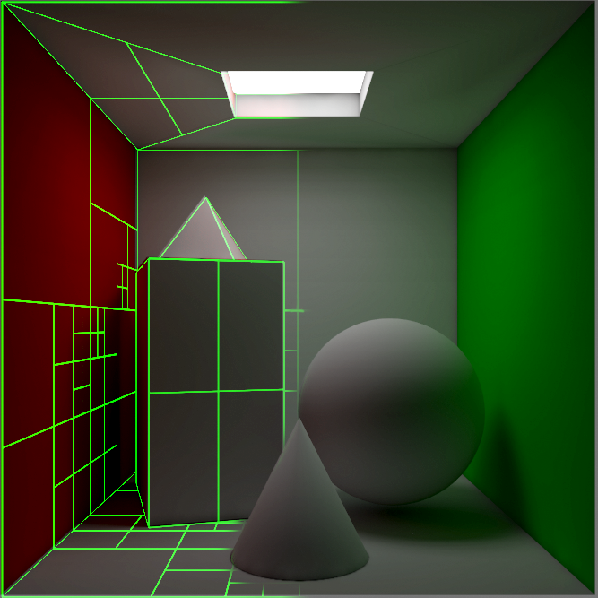
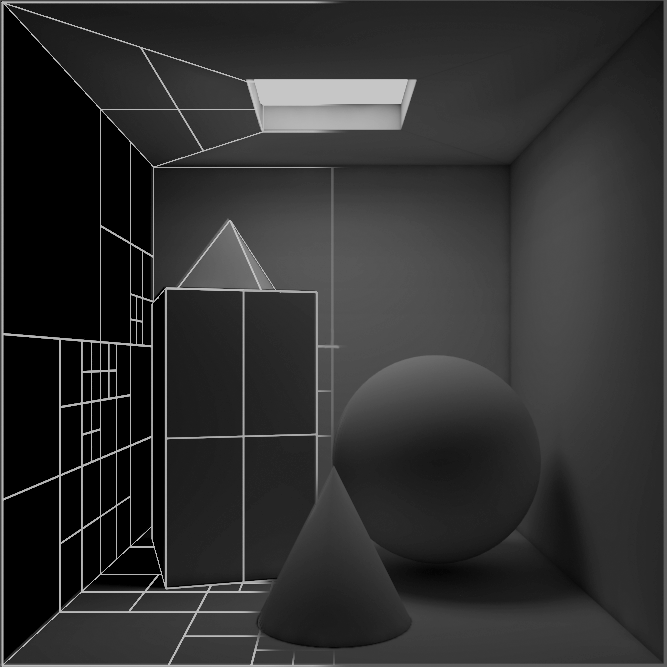
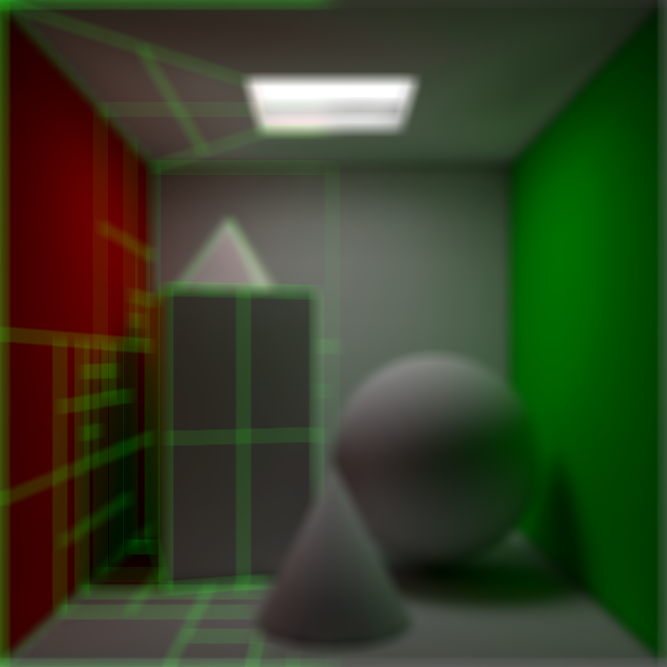

# Cuda_exercises
This repo will contain a various exercises/kernels etc. It's purprose is to learn cuda by doing things.

## Excercises

### Image to Gray Scale

[img_to_grayscale](exercises/img_to_grayscale)

This excercise is taken from Programming Massively Parallel Processors - Edition 5

Straight-forward one, just read image and save it to array (i've used stb_image and stb_image_write to read and save iamge data.). Then malloc required memory, in kernel convert multiple color channels int one channel using this formula:

$L = 0.299*r + 0.587*g + 0.114 *b$

**Image before:**

**Image after:**

### Image blurr

[img_blur](exercises/img_blur)

This excercise is taken from Programming Massively Parallel Processors - Edition 5

This task creates a blurry image simply by calculating the average of pixel values from around calculated pixel. The bigger radius the more blurry the image is.

**Image before:**

**Image after:**

